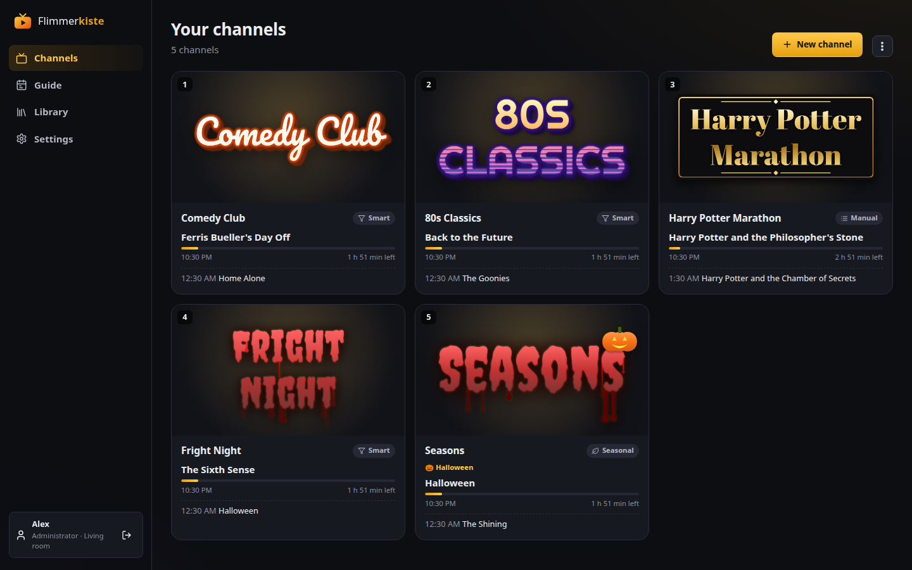
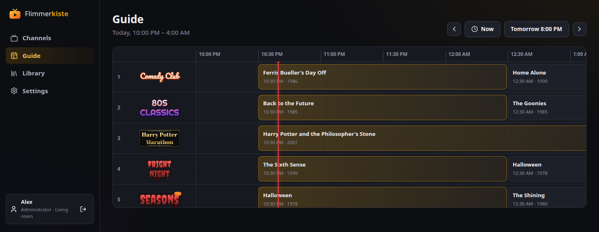
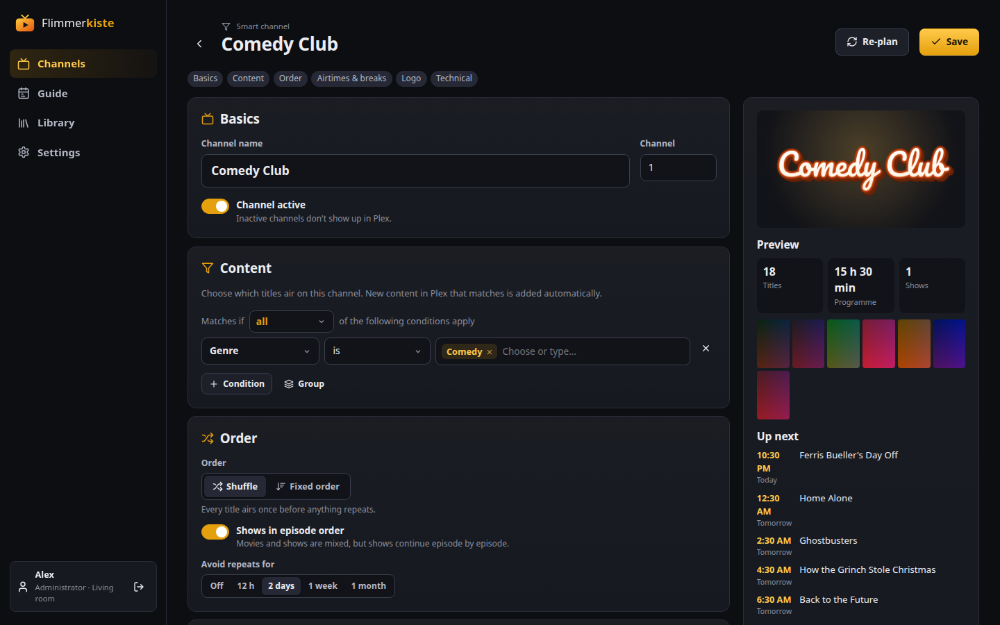
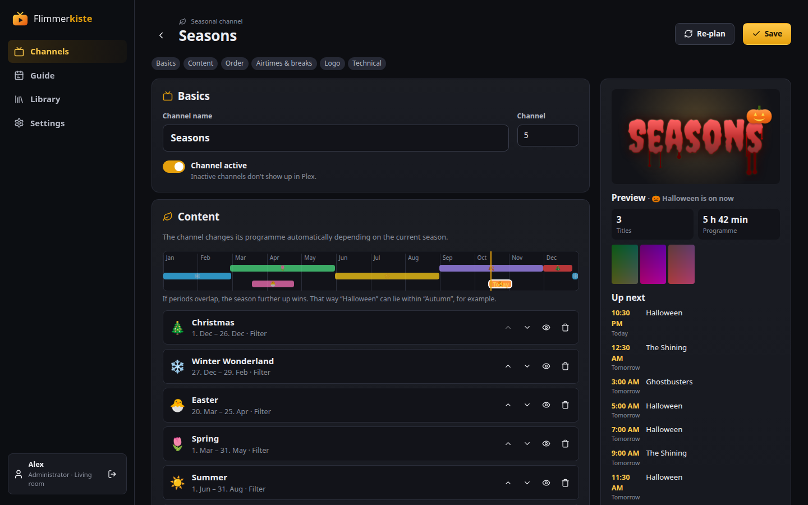
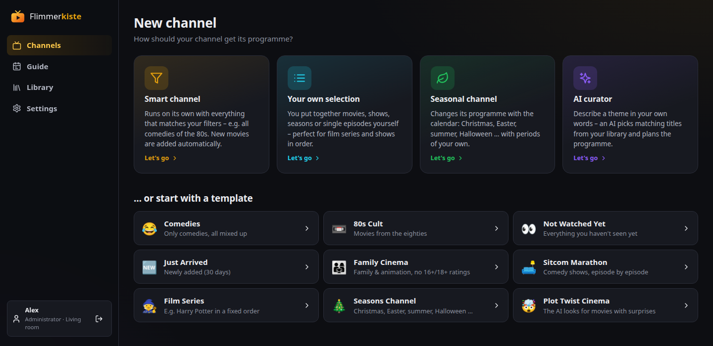
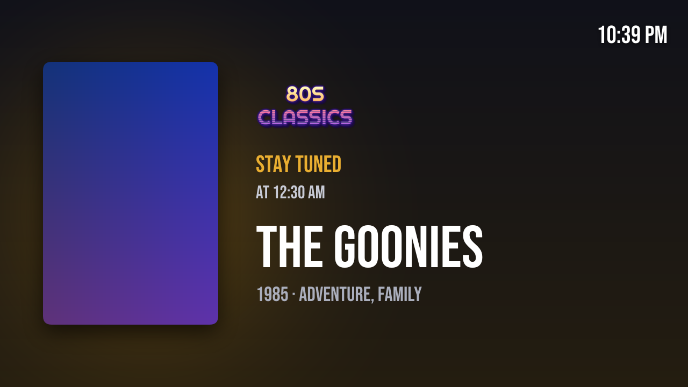
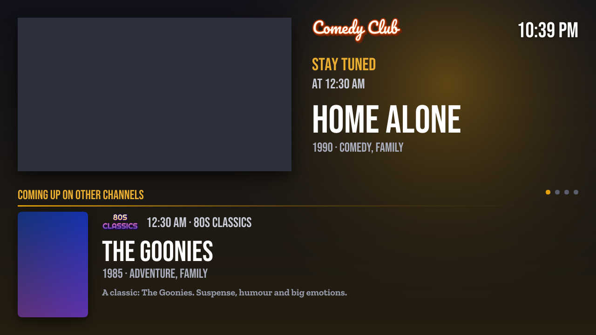
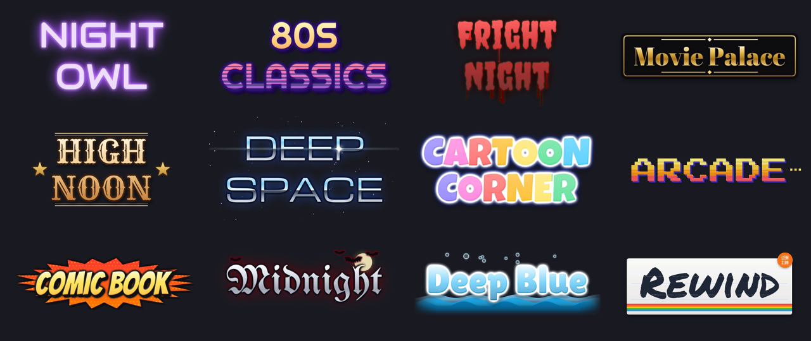

<p align="center">
  
</p>

<h1 align="center">Flimmerkiste</h1>

<p align="center">
  <b>Your own TV channels from your Plex, Jellyfin or Emby library.</b><br>
  Smart, seasonal and AI-curated channels with a real guide, slates, trailers and credits – right under Live TV.
</p>

<p align="center">
  <a href="https://github.com/shyper/flimmerkiste/actions/workflows/ci.yml"></a>
  <a href="LICENSE"></a>
  
  
  
</p>

<p align="center">
  
</p>

Flimmerkiste turns your movies and shows into channels that run like real TV: tune in and a movie is already
playing, the next one starts on the hour, and in between there are trailers and an “up next” slate.
It presents itself to the media server as an HDHomeRun tuner with an XMLTV guide, so the channels show up in
**Live TV** on every Plex, Jellyfin or Emby app – with logos and a full guide. Inspired by the Kodi add-on
*PseudoTV*; *Flimmerkiste* (“flicker box”) is German slang for the TV set.

## Highlights

- 📺 **Channels that build themselves** – filter rules, hand-picked lists, seasons (Christmas, Halloween …) or an AI
  curator that plans from a theme in your own words.
- 🕗 **Real TV timing** – titles start on round times, tuning in drops you into the running movie, the guide shows
  what really airs.
- 🎬 **Breaks like on TV** – trailers, clips from your library, “up next” slates with poster and music, previews of
  later films on the channel, weather and news.
- 🎨 **Logos in 38 styles** – generated from the channel name, with seasonal accessories, or your own upload.
- 🎞️ **Credits with an info panel** – the picture shrinks, the next title and highlights of other channels appear.
- 🪶 **Light on resources** – nothing runs while nobody watches; by default streams are only remuxed, encoding on
  the GPU (Intel, AMD, NVIDIA, Raspberry Pi 4) is optional.
- 🌍 **English and German** – interface, slates and guide.
- 🤖 **MCP for assistants** – ask Claude what's on, let it browse the library and set up channels, with tokens
  that carry only the rights you give them.

## Screenshots

<table>
  <tr>
    <td width="50%"><br><sub><b>Guide</b> – what airs on every channel, as the Live TV guide of your media server shows it too</sub></td>
    <td width="50%"><br><sub><b>Smart channel</b> – filter rules with a live preview of the coming titles</sub></td>
  </tr>
  <tr>
    <td><br><sub><b>Seasonal channel</b> – the programme follows the calendar</sub></td>
    <td><br><sub><b>New channel</b> – four kinds and ready-made templates</sub></td>
  </tr>
</table>

### On the TV

<table>
  <tr>
    <td width="50%"><br><sub><b>“Up next” slate</b> – fills the break until the next title starts on time</sub></td>
    <td width="50%"><br><sub><b>Credits panel</b> – what follows, and highlights on the other channels</sub></td>
  </tr>
</table>

<p align="center">
  <br>
  <sub>Channel logos are generated from the name – a few of the 38 styles</sub>
</p>

## Quick start

```bash
mkdir flimmerkiste && cd flimmerkiste
curl -fsSLO https://raw.githubusercontent.com/shyper/flimmerkiste/main/docker-compose.yml
docker compose up -d
```

Open `http://<server-ip>:8089`, choose Plex, Jellyfin or Emby and sign in – the assistant does the rest.
Details are under [Installation](#installation-docker).

## Features

### Channels

- **Smart channels**: filter rules with nested AND / OR / exclusion groups
  (genre, decade, actor, collection, label, rating, duration, watched …) and a live preview.
  Actors, directors and writers come from each title's full metadata, so supporting roles and guest stars count
  too. Episodes also match the description of their show, and the decade of an episode is every decade its show
  ran in (as far as its episodes are in the library).
- **Manual channels**: movies, whole shows, seasons or single episodes by drag & drop.
- **Seasonal channels**: the programme changes with the calendar, e.g. Christmas, winter,
  Easter, spring, summer, Halloween and autumn. A template is included; periods and content are up to you.
- **AI curator (optional)**: describe a theme in your own words, and Claude or an
  OpenAI-compatible model (also local through Ollama) plans the next titles. Its reasons show in the guide.
  The planner tries to fill `FLIMMERKISTE_EPG_HOURS` (48 hours by default) every 20 minutes.
  If an AI request fails, existing programme stays in place. Each planning run adds at most one
  random title, and only while less than half that horizon is prepared. The next planning run
  retries the AI to fill the full horizon.
  Both AI providers stream their responses. Requests allow up to 15 minutes in total,
  but stop after 4 minutes without incoming data. Only complete responses are used.
- **Order**: shuffled (every title once per round) or fixed, e.g. for film series.
  Shows can continue episode by episode even when shuffled. Repeats can be avoided.
- **Tune in at the right time**: tune in at 12:30 to a movie that started at 12:00 and it starts at minute 30.
- **Trailer-only channels**: a manual channel without titles plays its fillers around the clock,
  e.g. movie trailers. The guide shows “No program information available” in blocks of 6 hours.
- **Always up to date**: the sync with the media server (every 6 hours by default) finds new and deleted titles.
  Deleted titles leave the programme at once, also from manual lists, where the editor marks them.
  New matching titles join the programme from about 2 hours ahead, so what has been announced stays.
  Manually added shows and seasons get new episodes automatically. Fixed orders continue seamlessly.
- **Full metadata**: library listings name only the first few actors of a title (Plex), so every movie, show and
  episode is also fetched on its own and its whole answer is stored. New titles are fetched during the sync that
  finds them, the others again about every 30 days at a random time, a few every 10 minutes, so the requests spread
  over the day. The first sync after setup fetches everything once. The library page shows how many titles have
  full metadata, and a full scan per library fetches them all again.

### On screen

- **Logos**: upload your own, or the channel name is set automatically in one of 38 styles
  (retro, neon, cinema, horror, magic, epic, space, western, comic, anime, VHS, parchment …),
  with color themes, “shuffle”, a tagline, the channel number and an accent color taken from the channel's posters.
  At Christmas, New Year's Eve, Valentine's Day, Easter and Halloween automatic logos can wear a matching
  accessory (per channel). Seasonal channels change their logo with the season.
- **On-screen logo**: the logo is shown like on real TV, with adjustable position, size and opacity
  (needs the “Fully normalize” mode). With 4:3 and widescreen it sits at the corner of the picture instead of in the
  black bars (aspect ratio as reported by the media server). After the slate or the credits it fades in softly.
- **Airtimes & breaks**: titles can start at round times (e.g. 8:15 PM). Trailers, clips from your library
  (music videos, short films) and an “up next” slate with poster, title and start time of the next program
  fill the gap. The last clip of a break may run up to 45 seconds over so the slate doesn't stand too long.
  Breaks don't show in the guide.
- **Pages on long slates**: an “up next” slate of 20 seconds or more turns a page every 15 seconds, blending softly:
  the slate, what the coming title is about and when it starts (if it has a summary), the weather and the news (if set up, on every
  platform), the last two with a box naming the coming title. It ends on whatever page it is on, fading to black;
  the music plays on. Shorter slates stay as they are.
- **Credits with an info panel**: during the credits the logo fades out and the picture shrinks to the top left
  (without black bars for 4:3 or widescreen). Next to it you see what's up next, below highlights of the other
  channels take turns (movies and season premieres first). The sound stays unchanged. If a scene follows the credits, the picture stays big and a small
  card takes turns at the bottom left instead. Can be chosen globally and per channel; needs the “Fully normalize”
  mode. Where the credits are comes from Plex's credits detection (Plex Pass); Jellyfin and Emby don't report it,
  so there the small card shows over the last minute of a title.
- **Programme preview**: at the end of longer breaks the trailer of a movie or show airing later on the same channel
  plays, followed by a slate “Today at 10:00 PM”. A show is announced for a season premiere or its first episode in
  the programme, not for every episode. Titles in prime time are preferred.
- **Forced subtitles**: subtitles for foreign-language parts (a track marked “forced”, in the language of the audio)
  are burned into the picture automatically, because Live TV apps show no subtitle tracks. Works with picture
  subtitles (PGS, VobSub) and text subtitles (SRT, ASS, also as separate files), only in “Fully normalize” mode.
- **HDR films**: in “Fully normalize” mode, HDR10 and HLG titles are tone mapped to SDR, so they don't look pale.
  The tone mapping runs on the CPU after scaling to 720p/1080p (with the image's jellyfin-ffmpeg about three times
  faster than real time for a 1080p source on a small Intel CPU, also with GPU decoding and encoding). Without
  jellyfin-ffmpeg the slower standard filters (zscale) are used if ffmpeg has them. “Direct” and “Match audio” pass
  HDR on as it is. Dolby Vision without an HDR10 base layer is untested.

### Trailers and slates

- **Trailers**: only trailers in the preferred audio languages are used, optionally narrowed down by a filter
  (e.g. horror only). Sources:
  - *Library movies and shows*: on Plex its online trailers, available for many titles in many languages; on
    Jellyfin and Emby the local trailers in the media folders. They are looked up during the library sync (new
    titles at once, otherwise every 30 days).
  - *Cinema & streaming* (Plex): titles from Plex lists such as “Upcoming blockbusters” or “Coming soon” (chosen in
    the settings), fetched every 12 hours. After the trailer a slate shows the release date. Titles that have not
    been in any list for 14 days disappear again. On Jellyfin and Emby the TMDb slates below take their place.

  Online trailers stream on demand; only titles and links are stored. Shortly before it airs, a trailer is
  downloaded ahead and deleted after playing. The Plex lists use an interface that is not officially documented.
  If it fails, the other clips or the slate play instead.
- **“Coming soon” slates (Jellyfin, Emby)**: from The Movie Database (TMDb), with your own free API key
  (Settings → Trailers and previews): movies coming to theaters, the most popular new shows starting within three
  months (with a description in your language) and new seasons of your shows starting within three months. A slate
  shows the backdrop, poster, release date, genres, rating and plot for 15–30 seconds and is used as a filler like a
  trailer. Titles already in the library or already released are skipped; refreshed every 12 hours. New seasons
  take one request per show with a TMDb id on each refresh.
- **Weather and news slates**: on Jellyfin and Emby, so long breaks don't show the same few theater slates, weather
  and news slates join them; on every platform they are pages of long “up next” slates. The weather for one place
  (current conditions with the coming hours, and a four-day outlook) and the search for the place come from
  [Open-Meteo](https://open-meteo.com) (for Germany from the ICON model of the Deutscher Wetterdienst); its free service
  is for non-commercial use. The news are up to six headlines a slate in two columns, fewer if long ones need the room (source and time, no teasers or pictures) from RSS or Atom feeds
  you enter. No keys needed; weather is fetched every hour, news every 15 minutes, and the slates are drawn when they
  air.

### Media servers and setup

- **Plex, Jellyfin or Emby**: chosen at the first start. With Plex you sign in through plex.tv; the first account
  becomes the owner. With Jellyfin and Emby you sign in with name and password on that server; only one of its
  administrators can link it, and Flimmerkiste then keeps an API key of its own instead of the password. After that
  only people with an account on the linked server can get in (as viewers; roles can be changed).
- **One-click Live TV (Jellyfin, Emby)**: the assistant adds the tuner and the guide to the server and refreshes
  it. Emby needs Emby Premiere for Live TV. With Plex you add the tuner once by hand (see below).
- **Guide always current**: when the programme changes, Flimmerkiste asks the media server to reload the guide –
  but not while someone is watching, because a reload ends running Live TV streams.
- **History**: every movie and episode that aired, with channel and start, also when nobody watched; a title is
  noted once it has started, never ahead. It shows how often each title aired and how long before the last time,
  to check the shuffle, marks what someone tuned in to and what could not be played, and can be searched.
- **Export & import**: channels and their settings go into a JSON file (all or single channels) and into another
  installation, also from Plex to Jellyfin: titles are found again by their TMDb/IMDb/TVDB ids or by title and year.
  Conflicts with existing channel numbers can be skipped, replaced or added as new channels.
- **Languages**: English and German for the interface, the slates and the guide. A new installation takes the
  owner's browser language; it can be changed in the settings.

### Assistants (MCP)

Flimmerkiste is an [MCP](https://modelcontextprotocol.io) server at `http://<server-ip>:8089/mcp` (Streamable HTTP).
Assistants such as Claude Desktop, Claude Code or other MCP clients can then answer “what's on tonight?”, find titles
in the library (“which Christmas movies do I have?”) and build channels (“a channel with 80s action movies, starting
on the quarter hour”).

Create a token under **Settings → MCP** and tick what it may do:

| Permission | Tools |
|---|---|
| Read the guide (`read`) | `get_server_info`, `list_channels`, `get_channel`, `get_guide`, `get_sessions`, `get_history`, `get_seasonal_preset` |
| Read the library (`library`) | `list_libraries`, `search_library`, `get_title`, `get_show`, `library_facets`, `preview_source` |
| Change channels (`write`) | `create_channel`, `update_channel`, `regenerate_channel`, `regenerate_all`, `sync_library` |
| Delete channels (`delete`) | `delete_channel` |

A client only sees the tools its token allows. The token acts as the administrator who created it, with that
person's current role: if they become a viewer, only the guide tools remain (history and everything else are
for administrators). The token is shown once; only a hash is stored, and it can be revoked at any time. The library
tools read what Flimmerkiste has synced from the media server; `sync_library` fetches it again.

**Connecting a client:** Settings → MCP explains it step by step for Claude (app and web), Claude Code, Cursor and
VS Code, and ChatGPT, with the address and the new token already filled in. Best is a client that sends the token
in the `Authorization` header (`Bearer <token>`), as Claude, Claude Code and the editors can. For clients that can't,
the token can be part of the address: `/mcp/<token>`. The Claude and ChatGPT apps connect from the provider's cloud,
so Flimmerkiste has to be reachable over HTTPS from the internet; for Claude Code and editors the home network is
enough.

**From the internet:** publish Flimmerkiste only over HTTPS through a reverse proxy; the tuner endpoints stay
limited to the home network anyway. A token in the address is a password: keep one token per app with only the
rights it needs, and keep it out of the proxy's access log, for nginx:

```nginx
location /mcp/ {
    access_log off;
    proxy_pass http://127.0.0.1:8089; # and the same proxy settings as for location /
}
```

Flimmerkiste itself never writes a token to its log (it shows `fk_***`). Paths that are not a page of the web
interface answer 404.

## Resource usage

- **Idle:** only a small Go web server runs (about 4 MB RAM, 0 % CPU). The schedule is computed ahead
  and stored; no process has to run for it.
- **While watching:** ffmpeg starts only when the media server requests a channel. It jumps straight to the right
  position and reads in real time. In the default mode *Direct (remux)* the streams are only repackaged, not encoded.
  The stream runs 10 seconds ahead of real time (adjustable). If the next title starts slowly, such as a
  trailer from the internet, that only uses up this buffer and the picture doesn't freeze.

## Installation (Docker)

```bash
mkdir flimmerkiste && cd flimmerkiste
curl -fsSLO https://raw.githubusercontent.com/shyper/flimmerkiste/main/docker-compose.yml
docker compose up -d
```

Then open `http://<server-ip>:8089`, choose Plex, Jellyfin or Emby and sign in. The assistant leads through
the rest: choose the server, read the library and add the tuner.

The compose file uses the published image `ghcr.io/shyper/flimmerkiste:latest`, built from the default branch.
- **Update**: `docker compose pull && docker compose up -d`. The data in the volume stays.
- **Fixed version**: replace `latest` with a commit (e.g. `:3d40587`) or a release tag.
- **Build it yourself**: in a clone of the repository (`git clone https://github.com/shyper/flimmerkiste.git`),
  uncomment `build: .` in `docker-compose.yml` and run `docker compose up -d --build`.

**One image for all hardware** (amd64 and arm64): it uses [jellyfin-ffmpeg](https://github.com/jellyfin/jellyfin-ffmpeg),
which brings the drivers for Intel and AMD graphics along and supports NVIDIA and the Raspberry Pi 4 (see notes).

The data lives in the Docker volume `flimmerkiste-data` (reset with `docker compose down -v`).
The compose file uses `network_mode: host` because the media server usually runs on the same computer.
**Important:** `TZ` must be right, because seasons and airtimes use local time.

| Variable | Default | Meaning |
|---|---|---|
| `FLIMMERKISTE_LISTEN` | `:8089` | Address/port |
| `FLIMMERKISTE_DATA_DIR` | `/data` | Database, logos, cache |
| `FLIMMERKISTE_PLEX_URL` | – | Plex only: fix the server address instead of choosing it in the assistant |
| `FLIMMERKISTE_BASE_URL` | – | Fixed address under which the media server reaches the tuner |
| `FLIMMERKISTE_EPG_HOURS` | `48` | How far ahead the programme is planned |
| `FLIMMERKISTE_LOG_LEVEL` | `info` | `debug` also shows the ffmpeg calls |
| `FLIMMERKISTE_TUNER_ALLOW` | – | More addresses for the tuner endpoints (see notes), e.g. `100.64.0.0/10` or `all` |
| `FLIMMERKISTE_TRAILER` | – | Trailer folder filled by `scripts/trailers.py` (see helper scripts), e.g. `/trailers` |

### Adding the tuner to the media server

**Jellyfin or Emby:** the assistant (and Settings → Live TV and tuner) does it with one click. By hand: Dashboard →
**Live TV** → add a tuner of type **HDHomeRun** with `http://<server-ip>:8089` and an **XMLTV** guide provider with
`http://<server-ip>:8089/epg.xml`. Emby needs Emby Premiere for Live TV.

**Plex:** Settings → **Live TV & DVR** → **Set up DVR**, “Enter network address manually”:
`http://<server-ip>:8089`, then choose **XMLTV** as the guide: `http://<server-ip>:8089/epg.xml`.
Live TV & DVR in Plex requires a Plex Pass.

## Notes

- The tuner endpoints (`/discover.json`, `/lineup.json`, `/stream/…`) need no sign-in,
  because media servers cannot sign in there. They therefore only answer requests from the local network
  (loopback, private networks, addresses of the computer itself) and block everything that comes
  through a reverse proxy (`X-Forwarded-For`, `X-Real-IP`, `Forwarded`, `CF-Connecting-IP`).
  The web interface can be published that way. The media server has to reach the tuner directly, not through the
  proxy. Blocked requests are logged. If the media server runs in another network (e.g. Tailscale `100.64.0.0/10`),
  add its addresses to `FLIMMERKISTE_TUNER_ALLOW`. `all` turns the restriction off.
- The guide `/epg.xml` can be reached without sign-in from anywhere, also through a
  reverse proxy (e.g. for external EPG apps). It only contains titles, descriptions and image links.
- If a channel hangs when switching between two titles (different codecs),
  the channel's technical option *Match audio* or *Fully normalize* helps.
  The latter needs a lot of CPU without a GPU.
- Flimmerkiste streams movies and shows from the media server. In the Docker container there is a more direct way:
  mount the media folders read-only in `docker-compose.yml` (e.g. `/mnt/media/Movies:/movies:ro`) and map them to
  the server's folders under **Library**. Saving checks a few samples. The files must be readable for UID 1000.
  Without a container, the server's paths are used directly when they are readable. If a file is missing, it goes
  through the media server.
- With an Intel or AMD GPU, *Fully normalize* encodes on the graphics unit (VAAPI). It only decodes there too if the test at
  startup showed it clearly faster than real time (on small chips such as the J3455 the CPU is faster at it); it can be
  turned off under Settings → Hardware. Pass `/dev/dri` through in `docker-compose.yml` and add the group id of
  `render` (`getent group render`) with `group_add`. Whether the GPU was found is logged at startup and shown under
  Settings → Hardware. Another device: `FLIMMERKISTE_VAAPI_DEVICE`.
- With an **NVIDIA** card (experimental), *Fully normalize* encodes with NVENC when VAAPI is not usable; decoding,
  scaling and overlays stay on the CPU. Install the NVIDIA Container Toolkit on the host and add `gpus: all` in
  `docker-compose.yml`. Another device: `FLIMMERKISTE_NVIDIA_DEVICE`. Untested on real hardware so far – reports welcome.
- On a **Raspberry Pi 4**, *Fully normalize* encodes on its hardware encoder (V4L2) when VAAPI and NVENC are not usable; decoding,
  scaling and overlays stay on the CPU. Pass `/dev/video11` through in `docker-compose.yml` and add the group id of
  `video` (`getent group video`) with `group_add`. Another device: `FLIMMERKISTE_V4L2_DEVICE`. Untested on real hardware so
  far – reports welcome. The Raspberry Pi 5 has no hardware encoder; there everything runs on the CPU.

## Helper scripts

The scripts in `scripts/` run apart from Flimmerkiste, on any computer that reaches the media server, and are meant
for cron. Most exist per media server; all of them skip what they handled before (state file next to the
script), start only once at a time, and with `--silent` print nothing except one line on stderr (exit code 1) when the
server cannot be reached. `--dry-run` only shows what they would do; `--help` lists all options.

| Script | What it does |
|---|---|
| `plex_themes.py` | Theme songs from ThemerrDB, uploaded to Plex (no access to the media files needed); `--replace-plex` also replaces the ones Plex hosts itself, which stop after 30 seconds |
| `jellyfin_themes.py`, `emby_themes.py` | Theme songs from ThemerrDB, saved as `theme.mp3` in the folder of the movie or show |
| `plex_subtitles.py`, `jellyfin_subtitles.py`, `emby_subtitles.py` | Text subtitles embedded in video files, saved as files of their own (`Movie.de.forced.srt`) |
| `trailers.py` | Trailers of new movies from KinoCheck and TMDb, saved in the trailer folder (any media server) |

**Why the subtitle scripts:** Flimmerkiste burns forced subtitles into the picture (“Fully normalize” only). Picture
subtitles (PGS, VobSub) it reads from the video itself, text subtitles (SRT, ASS) it needs as a file: Plex hands out
none for tracks inside a video, and Jellyfin and Emby extract them by reading the whole video, which takes far too
long when a channel is tuned in. The
scripts copy those tracks out once (ffmpeg reads each file completely, with low priority) and name them the way all
three servers read them. By default only forced tracks are saved, `--all` saves every text track. In ordinary apps
the track then shows twice, embedded and as a file. Flimmerkiste always uses the file. If the media folders are
mounted (Library page), it also finds the file next to the video before the server has picked it up.

The themes scripts need yt-dlp (current version), ffmpeg and deno or node; the subtitle scripts ffmpeg and ffprobe.
Except for `plex_themes.py`, they write into the media folders: run them where the files are writable, and if the
server sees them under other paths, translate with `--map SERVER=LOCAL` (repeatable). Jellyfin and Emby need an API
key (dashboard → API Keys). Jellyfin picks new files up right away; Emby finds new theme songs only with a library
scan, which `emby_themes.py` starts after a run that saved some.

```bash
# crontab -e: theme songs every night at 3, subtitles at 4 (Plex)
0 3 * * * PLEX_URL=http://127.0.0.1:32400 PLEX_TOKEN=xxxx /opt/flimmerkiste/scripts/plex_themes.py --silent
0 4 * * * PLEX_URL=http://127.0.0.1:32400 PLEX_TOKEN=xxxx /opt/flimmerkiste/scripts/plex_subtitles.py --map /data=/mnt/media --silent

# Jellyfin (Emby the same with EMBY_URL / EMBY_API_KEY and emby_*.py)
0 3 * * * JELLYFIN_URL=http://127.0.0.1:8096 JELLYFIN_API_KEY=xxxx /opt/flimmerkiste/scripts/jellyfin_themes.py --map /media=/mnt/media --silent
0 4 * * * JELLYFIN_URL=http://127.0.0.1:8096 JELLYFIN_API_KEY=xxxx /opt/flimmerkiste/scripts/jellyfin_subtitles.py --map /media=/mnt/media --silent
```

**Trailers of new movies:** `trailers.py` fills a folder with trailers of the movies now playing and coming soon in
cinemas (TMDb lists of `--region`), so breaks also advertise new movies with Jellyfin and Emby or besides Plex
Discover. It looks for a trailer in the languages of `--language` in order (`de,en`): German ones at KinoCheck first,
then at TMDb. Next to each video it writes a `.json` with what Flimmerkiste shows (title, year, genres, age rating,
summary, poster, release date); the name carries the TMDb and IMDb ids, e.g.
`Movie (2026) [tmdbid-123] [imdbid-tt1234567] de.mp4`. `--max-height` limits the quality (default 1080), and trailers
are deleted `--keep-days` after the release (default 60). It needs a TMDb API key (themoviedb.org → Settings → API),
yt-dlp, ffmpeg and deno or node; its state lies in the trailer folder. Mount the folder into the container and
set `FLIMMERKISTE_TRAILER` (see `docker-compose.yml`): Flimmerkiste reads it every 10 minutes and plays its trailers
like those of “cinema & streaming”, followed by the release date slate. Movies you already have are left out. A
video replaces the TMDb slate of the same movie.

```bash
# trailers of new movies every night at 5
0 5 * * * TMDB_API_KEY=xxxx /opt/flimmerkiste/scripts/trailers.py --dir /mnt/media/Trailer --language de,en --silent
```

Tests: `python3 -m unittest discover -s scripts -p 'test_*.py'` (needs ffmpeg).

## CI/CD (GitHub and GitLab)

Both run the same checks on every push and merge/pull request:

- **lint**: `gofmt` and `go vet`
- **test**: all Go tests including the end-to-end test (fake Plex, real ffmpeg, MPEG-TS streams), and the tests of
  the helper scripts
- **web**: frontend tests and build
- **docker**: builds the image. From the default branch it is pushed as `:latest` and `:<commit>`, for Git tags also
  as `:<tag>`. Merge/pull requests only build.

Tests run with jellyfin-ffmpeg as in the image (`build/jellyfin-ffmpeg.sh` installs it on Debian or Ubuntu).

**GitHub** (`.github/workflows/ci.yml`) publishes to the GitHub container registry (`ghcr.io/<owner>/<repo>`) and
builds the standard image for amd64 and arm64 (Raspberry Pi). **GitLab** (`.gitlab-ci.yml`) publishes to the GitLab
container registry, amd64 only; its Docker job uses Docker-in-Docker and needs a runner with `privileged = true`.
The compose file uses the GitHub image `ghcr.io/shyper/flimmerkiste:latest`; a fork points it at its own registry.

## Development

```bash
# Backend (the frontend has to be built once: cd web && npm install && npm run build)
go run ./cmd/flimmerkiste

# Frontend with hot reload against the running backend
cd web && npm run dev

# Tests
go test ./...
FLIMMERKISTE_E2E=1 go test -run TestE2E -v ./internal/server/          # needs ffmpeg: fake Plex + a real stream
FLIMMERKISTE_DEMO=1 go test -run TestDemo -timeout 0 ./internal/server/  # UI demo with sample data on :18090
cd web && npm test                                                 # editor, pages in both languages, catalogs
```

**Jellyfin and Emby** are tested against real servers in containers (`test/mediaserver`). The media is generated
with ffmpeg, metadata comes from NFO files, so no internet is needed:

```bash
cd test/mediaserver && ./make-media.sh && docker compose -p flimmerkiste-test up -d
FLIMMERKISTE_MEDIASERVER_E2E=all go test -count=1 -v ./internal/jellyfin/   # or =jellyfin / =emby
docker compose -p flimmerkiste-test down -v
```

The tests set up both servers, sign in, read the library and set up Live TV against a fake tuner. Live TV on
Emby needs Premiere and only runs with `FLIMMERKISTE_EMBY_PREMIERE=1`.

**What viewers see is pinned by golden tests.** Slates, lower thirds, the credits panel and card, the clock,
logos, the XMLTV guide and the AI prompt are compared with references in `testdata/golden` (pixel by pixel for
pictures), in both languages and at fixed times in Berlin. After an intended change, rewrite them and look at
the pictures: `FLIMMERKISTE_GOLDEN_UPDATE=1 go test ./internal/server ./internal/logo ./internal/ai`.
The web pages are compared with snapshots (`web/src/tests/__snapshots__`); accept intended changes with
`npx vitest run -u`. Their API answers are recorded with `FLIMMERKISTE_WEB_FIXTURES=1 go test -run TestWebFixtures ./internal/server/`.

**Texts:** the server's texts are in `internal/i18n` (`de.go`, `en.go`), the interface's in `web/src/locales`.
Tests make sure every text exists in both languages with the same placeholders.

**Older data:** after an update the database holds channels saved by earlier versions.
At startup their configurations are brought into the current format (`schedule.ParseConfig`), and the editor
fills in missing fields in `web/src/lib/config.js`. If the format changes, an example in the old format goes
into `internal/schedule/testdata/configs/`. Go tests and editor tests open each of them
(update the reference: `go test ./internal/schedule -run StoredConfigs -update`).

Layout: `internal/mediaserver` (what Flimmerkiste needs from a media server), `internal/plex` (plex.tv sign-in,
server API and its implementation of `mediaserver`), `internal/jellyfin` (the same for Jellyfin and Emby),
`internal/tmdb` (upcoming movies, new shows and seasons for the slates), `internal/weather` and `internal/news` (weather and news slates),
`internal/library` (metadata mirror), `internal/rules`
(filter engine), `internal/schedule` (planning, seasons, AI), `internal/stream` (ffmpeg/MPEG-TS),
`internal/logo` (logo generator, slates), `internal/i18n` (texts and formats), `internal/server`
(HTTP, HDHomeRun, XMLTV, API), `web/` (Svelte interface, embedded into the binary).

## License

MIT – see [LICENSE](LICENSE). Third-party files keep their own licenses, which lie next to them:
the fonts and emoji graphics under `internal/logo` (SIL Open Font License, Apache 2.0, CC-BY 4.0) and the
default slate music in `internal/stream/assets` (Pixabay Content License).
